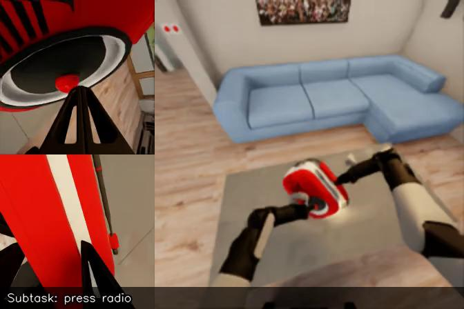

# SILab-DreamX：1688977 提交与本机复现

本页记录最终提交使用的 checkpoint、固定镜像，以及 2026-10-17 完成的本机完整回合。
1000 回合成绩来自提交时的自测；本机额外回合用于验证已提交镜像能够运行，单独保存。
官方审核和官方成绩以主办方公布为准。

## 提交版本与成绩

| 项目 | 值 |
| --- | --- |
| 队伍 | SILab-DreamX |
| Checkpoint | 1688977 |
| 评测模式 | `public_test`、`whole_task`、默认 R1Pro 和 `DefaultWrapper` |
| 提交自测范围 | 100 个任务，每个任务公开实例 301–310，各 1 回合，共 1000 回合 |
| 完整任务成功率 | 77/1000 = **7.70%** |
| 平均 Q | **0.23253169330669357** |
| 条件输入 | 完整任务提示；模型自主生成 subtask；无 oracle、无外部 selector |

1688977 使用 `task_and_subtask` 动作条件。不要用仓库当前训练脚本的
`subtask_only` 默认值覆盖旧 checkpoint 的模式，或把后续训练实验视为本次提交版本。

## 公开策略镜像

标签：`docker.io/faye0138/behavior-pi05-1688977:1688977-video-20261014`

Manifest digest：
`sha256:469ddc6a55ee7e2f1a9486c3d366b1de7c44469750562bc628b099c4f88c2dea`

Config digest：
`sha256:ae53492e21d915a832cbd68d129c9ca9013e029a18838f1f01651bad3db38a9e`

镜像包含该版本的策略源码、运行环境、归一化统计和模型权重，可匿名拉取。
下面的示例在已安装 Docker 和 NVIDIA Container Toolkit 的独立评测机器上执行，
先确认所选 GPU 没有其他计算任务：

```bash
IMAGE=docker.io/faye0138/behavior-pi05-1688977@sha256:469ddc6a55ee7e2f1a9486c3d366b1de7c44469750562bc628b099c4f88c2dea
docker pull "$IMAGE"
docker run --rm --gpus device=0 --shm-size=8g \
  --hostname b1k-policy --add-host b1k-policy:127.0.0.1 \
  -e XLA_PYTHON_CLIENT_PREALLOCATE=false \
  -e TASK=turning_on_radio -p 127.0.0.1:8000:8000 "$IMAGE"
```

`TASK` 必须与评测器任务相同。容器提供 WebSocket 策略服务；OmniGibson 和官方资产在
独立的评测环境中运行。不要用外部目录挂载覆盖镜像的 `/mnt/afs`，以免遮蔽已打包的权重、
源码和环境。镜像摘要固定了本次提交内容，代码仓库后续更新不会改变该镜像。

## 外部评测器与官方资产

使用提交材料中附带并校验过的冻结评测源码，OmniGibson **3.9.3**、Isaac Sim **5.1.0.0**、
Python **3.11**。该源码包含本项目的评测适配；本页命令不表示任意上游安装均具备相同接口。
评测源码和原始 1000 回合结果包已通过最终表单提供给主办方。

资产来自 [behavior-1k/zipped-datasets](https://huggingface.co/datasets/behavior-1k/zipped-datasets)，
固定 revision 和每个 ZIP 的 SHA256 见 [official_datasets.json](assets/1688977/official_datasets.json)：

- `behavior-1k-assets-3.9.0.zip`
- `omnigibson-robot-assets-3.8.2.zip`
- `2026-challenge-task-instances.zip`

按官方流程取得资产访问权限和密钥；将 `OMNIGIBSON_DATA_PATH` 指向解压后的数据根目录。
以下命令在独立评测环境中运行，策略服务已监听同一主机的 8000 端口：

```bash
export OMNIGIBSON_HEADLESS=1
export OMNIGIBSON_DATA_PATH=/path/to/omnigibson-data
export OUTPUT=/path/to/new-evaluation-output

python -m omnigibson.eval.eval \
  --task-name turning_on_radio --host 127.0.0.1 --port 8000 \
  --mode public_test --prompt-mode whole_task --policy websocket \
  --instance-indices 0 --num-rollouts 1 \
  --env-wrapper omnigibson.eval.wrappers.DefaultWrapper \
  --output-dir "$OUTPUT" --write-video
```

`--instance-indices 0` 对应公开实例 301，采用默认 seed 0 和官方回合时限，无 `--max-steps`
覆盖。复现一个任务的全部十个公开实例时改为 `--instance-indices 0 1 2 3 4 5 6 7 8 9`。
不同实例分组和进程启动方式可能改变随机状态消耗，不保证轨迹逐帧相同。

## 2026-10-17 本机完整回合

| 项目 | 结果 |
| --- | --- |
| 任务 / 实例 / rollout | `turning_on_radio` / 301 / 0 |
| 任务完成 | `success=true`，最终目标判定成功 |
| 最终 Q | 1.0 |
| 步数 | 2253 |
| 结束方式 | `terminated=true`，`truncated=false` |
| 视频 | H.264，672 × 448，30 fps，75.1 秒，2253 帧 |
| 硬件 | NVIDIA RTX 6000 Ada Generation，48GB；策略与仿真使用同一张空闲卡 |

[观看或下载完整视频](assets/1688977/turning_on_radio_301_0.mp4) ·
[原始结果 JSON](assets/1688977/turning_on_radio_301_0.json) ·
[校验记录与 SHA256](assets/1688977/verification.json)



模型生成的子任务依次为 `move to radio`、`pick up from radio to coffee table koagbh`、
`press radio`，切换分别发生在第 0、496、2064 步。完整视频已逐帧解码验证，SHA256 为
`b2ab720300937e0d9b369791f7aaea408045132fe2789771a17bb1092241b2d6`。

本机将镜像与资产放在数据盘，用 rootless OCI runtime 加载原镜像，验证配置及全部层内容后
运行原策略入口。策略和评测器通过私有 loopback 通信，只向容器暴露所选 GPU。
启动前连续检查无计算进程及足够空闲显存；没有停止或暂停其他人的 GPU 任务。

准备期间修复的是外部仿真环境：补齐 Warp 1.12.0、coverage 及编译所需的标准库和 git，
修复 setuptools/packaging 文件和环境库搜索路径，并通过无空格路径运行 Torch 编译器。
最终回合正常结束并保存视频；早期失败尝试未计入提交的 1000 回合成绩。
最终日志中的 Gymnasium 类型转换、音频设备和仿真 API 提示未阻止回合完成。

这是一个额外实例的运行验证，不是全量重新评测或官方验收结果。
此前的 23000 MiB 可用显存预算验证仅覆盖策略推理；本回合在物理 48GB 卡上运行，
没有物理 24GB GPU 或“策略加仿真合计 24GB”实测结论。

## 材料访问

原始 1000 回合的完整视频索引、结果包和复现源码通过已提交表单中的只读签名链接交付。
2026-10-16 的访问复核中，1000/1000 视频均可读取，README 和结果包可访问，
公开镜像 manifest/config 校验一致。这是当日检查记录，不代表持续在线监控。

表单中原视频页面的链接有效至北京时间 **2026-12-14 11:39:44**；其他签名链接以各自
到期时间为准。私有材料链接和凭据不放入公开仓库。上面的本机演示视频直接保存在本仓库。
