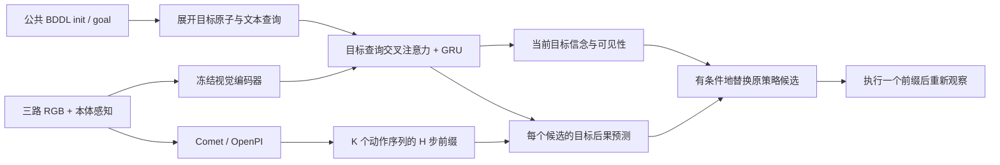

# GoalKeeper：面向 BEHAVIOR 2026 的目标信念与动作后果预测

方案状态：研究假设与可运行核心原型。没有 BEHAVIOR 实测结果，也尚未证明论文新颖性。本文将已实现机制、待做实验、条件性数学结论分开描述。

## 要解决的具体问题

长任务的失败未必来自“不知道下一步”。策略可能没放稳物品就继续，重复操作已经完成的对象，或者搬运过程中破坏此前满足的目标。只优化动作模仿或时间阶段，难以区分“演示通常走到这里了”和“目标现在确实完成了”。

我们的假设是：**把公共 BDDL 目标变成可查询、可撤销的视觉信念，再预测候选动作对各个目标的影响，会比同预算的标量进度预测更有效，尤其是在重复对象、遮挡、意外回退和目标组合变化时。** 这是假设，不应先写成实验结论。

主干先使用 Comet 的 OpenPI 策略或 2026 官方 π0.5。冻结主干训练小预测器，验证收益后才花大预算微调主干。2025 权重不能直接等同于 2026 已复现基线：任务覆盖、机器人配置、状态顺序、动作空间和控制方式都要重新核对。

## 已实现的数据流

1. BDDL 编译器把支持的 `and/or/not/forall/exists/=` 展开为目标原子和析取范式。`init` 仅作为公共静态上下文，绝不在重置时写入“当前已完成”。存在量词的不同对象绑定构成不同目标分支。
2. 冻结 SigLIP 提供图像 patch 特征和目标查询文本特征；每个目标独立查询三路相机 token，结合本体感知，经 GRU 累积决策时刻的历史。
3. 观测头估计当前原子真值和可见性；动作编码器输入将真正执行的 H 步动作，预测每个原子在前缀末端的真值。各目标共享参数，允许新目标组合复用。
4. 离线校准按初始状态分组；同组的帧、原子和分支不被算成独立样本。样本不足的预测返回未知区间。遮挡后旧信念区间逐步变宽；新证据可撤销旧完成状态。
5. 只保护当前一个一致目标分支中的高置信目标。非默认候选必须同时满足：估计回退风险低、相对原候选效用更高、相对当前状态有正进度。否则执行候选 0。

这里的“保护”是筛选启发式，不是安全盾，也没有无退化保证。默认候选可能破坏已有目标。这样允许“最终要求柜门关闭，但必须先开门放杯子”的必要中间动作；当前实现仅防止无进展的保守动作压过原策略，并没有学会完整的任务依赖规划。

## 和已有工作的区别必须怎样证明

| 相关方向 | 已有工作包含什么 | 本方案应该验证的区别 |
|---|---|---|
| Comet | 强模仿学习主干、额外轨迹、成功轨迹再训练 | 同一主干、同一控制方式下，目标后果预测能否增加完整任务成功 |
| 2025 RLC 冠军 | 阶段预测与动作工程 | 真实目标回退发生时，信念比时间/阶段标签是否更可靠 |
| ForesightFlow | 联合生成动作与标量成功潜力并筛选 | 因子化目标、可撤销记忆、关系级后果是否胜过同预算标量 critic |
| MPVI | 推理、技能执行与验证，还有地图/定位条件 | 在仅用比赛允许传感器时，是否仍有稳定收益 |
| SERF | 空间记忆与恢复，实验有额外感知信息 | 是否能在无实时实例标签输入下提高长任务恢复能力 |

“使用 BDDL”“层次控制”“加一个 critic”“加记忆”本身都不能作为充分创新点。比较也不能只挑几个我们表现好的短技能片段。论文应围绕 **目标因子化的动作后果建模能否减少不可恢复回退，并在目标组合变化时泛化**，用下述实验决定是否成立。

## 可以严谨陈述的条件性结论

令公共目标的 DNF 分支为 \(\mathcal C\)，每个分支是一组带正负号的文字。定义研究用进度

\[
\Phi(z)=\max_{C\in\mathcal C}\frac{1}{|C|}\sum_{\ell\in C}\mathbf1[\ell(z)].
\]

这不是官方 `q_score` 的重新实现。不同逻辑形式下，两者可能不同；榜单必须读取官方评测 JSON。

假设给定历史 \(h\) 和候选 \(a\)，所有目标文字具有**有效的条件概率下界** \(L_\ell(h,a)\le P(\ell(z_{t+H})\mid h,a)\)。则

\[
\underline\Phi(h,a)=\max_C\frac1{|C|}\sum_{\ell\in C}L_\ell(h,a)
\le\mathbb E[\Phi(z_{t+H})\mid h,a].
\]

证明：任一分支的平均下界不超过该分支的期望进度；期望最大值不小于任一分支期望；对分支取最大即可。对选定保护集合 \(P_t\)，联合界给出

\[
P(\exists\ell\in P_t:\neg\ell(z_{t+H})\mid h,a)
\le \min\{1,\sum_{\ell\in P_t}(1-L_\ell(h,a))\}.
\]

不要求各目标独立。负文字的下界要由原子上界变换为 \(1-U\)，不能直接沿用正文字下界。

这两条是基础性质，**不作为新的理论定理来包装**。当前实现的分组可靠性分箱只能估计校准分布下的群体可靠性；它不是每个机器人状态的条件下界。条件假设不成立时，上述式子不能解释为真实机器人风险保证，尤其不能从训练场景推广为新场景保证。

如果要增加理论贡献，值得研究的问题是：利用训练时的分支回放，以有限校准预算构造对“是否覆盖原策略”的风险控制规则，明确控制的是哪种分布、哪类干预事件和什么损失。需要先解决自适应选择、多目标相关性与分布偏移，不能直接套 conformal 名称就宣称解决。当前代码未实现这一扩展。

## 训练信号与最容易出错的地方

观测真值损失只在有可见性监督的目标上计算；可见性未知标为 -1。动作后果损失使用前缀末端真值。K 个同状态分支都实际执行后，才启用成对排序损失。不能把演示的结果同时贴到 K 个未执行动作上。

数据优先级：先重放训练 demonstrations 得到 K=1 样本；再针对“主干容易失败、已完成目标可能被碰坏、候选动作分歧大”的训练状态采集 K=4 分支。保留失败和回退轨迹，避免只有成功样本的 critic 学不到风险。

目前导出器接受已标注的训练 episode NPZ，完成特征提取与前缀对齐；尚未实现和验证特定集群上的 OmniGibson 回放/分支采集器。需要真实仿真环境才能验证物理状态恢复、随机数恢复和分支标签是否一致。正式数据必须在训练模式下采集；运行时策略不接收 truth、visibility 标签或 simulator object scope。

实例 ID 本身不是视觉指代。两个同类杯子无法凭名字 `cup_1/cup_2` 从图像唯一绑定时，应保留不确定性；当前共享查询头没有显式对象跟踪，复杂重复对象任务是重点风险。下一步是否加入视觉对象槽与跨帧关联，应由该子集误差决定。

## 实验与投入门槛

先从公共任务列表预先固定 12–16 个诊断任务，覆盖收纳、容器开关、多物体整理、开关设备、遮挡和长导航。不能依据本方法成绩挑选。具体任务名必须来自真实 100 任务列表，尚未在这里伪造名单。

| 实验 | 必须保持一致 | 要回答的问题 |
|---|---|---|
| 官方 Comet/π0.5 原始运行 | 权重、规范化、官方机器人与评测器 | 主干在 2026 上是否真的跑通 |
| 本仓库 `baseline` | 同主干，固定 H 的前缀执行 | 接口和控制方式变化本身影响多少 |
| `shadow` K=4 | 采样与预测均运行，只执行候选 0 | 去除推理预算和执行时序的混淆 |
| 标量 critic K=4 | 同数据量、编码器、参数预算、候选集合 | 目标因子化有无额外价值；此基线待实现 |
| 完整 `rerank` K=4 | 同 H、同种子协议、同任务/实例 | 本方案是否真正提高 Q 和完整成功率 |
| 去掉记忆 / 回退惩罚 / init 上下文 | 各自只改变一项，重新训练或校准 | 各机制是否必要；消融训练待运行 |
| 目标组合、场景与初始状态留出 | 分别划分，不能混称泛化 | 泛化来自组合能力还是记忆场景 |

模型选型与阈值只使用训练数据内部的 dev/calibration 划分；官方 public test 作为报告集，不能拿其 privileged labels 训练。当前自动 hash 划分只隔离初始状态；场景留出和任务组合留出需要单独的数据清单和训练运行，尚未实现自动 split 模式。

先通过四个门槛再扩张：① baseline 接口和单卡内存正确；② 离线动作后果比常数/当前状态不变预测更好，特别是稀有回退事件；③ 小规模闭环中干预的收益超过造成的损害；④ 固定任务集合的配对 Q 差异置信区间为正且完整成功率不下降。门槛是投入决策，不能预先承诺提高多少分。

正式报告：官方 100×10 规定 rollout 的 Q 与成功率；缺失实例记零；保存原始 JSON 和视频。另报每任务结果、候选数量、实际干预率、放弃干预率、目标回退事件、恢复成功率、P50/P95 推理延迟和峰值显存。置信区间按同一任务内的实例配对 bootstrap；它不能代表未见任务泛化的不确定性。

## 32 张 H20 的建议用途

第一阶段先用 1–4 张做冻结特征提取和小预测器训练，验证主干后再安排 8–16 张微调；剩余资源用于多个独立种子/模型对照和离线推理。通过诊断实验后，再将主干训练扩至 24–32 张。这里不是已经提交的资源分配，也不是测得的最优吞吐。

32 卡 DDP 入口只训练小预测器，不是“32 卡 Comet 全参训练已实现”。Comet/π0.5 应在相应上游训练环境中扩展训练配方。用户已确认另有 RTX 5090 仿真机器，因此采用 H20 训练/推理、5090 运行 OmniGibson 的部署分工；5090 数量、仿真并发、驱动及实际连接路径待确认。最终 Docker 提交受单张 24GB 推理 GPU 约束；必须测主干、编码器、候选缓存的总峰值，而不是单看这个小头。

预计四个阶段：环境与基线复现 → 数据重放与小头 → 匹配计算量的闭环实验 → 全量评测与论文。具体工期取决于仿真并发、数据已有程度、失败率和存储吞吐，目前没有依据承诺固定天数。

## 核查过的主要来源

2026 年 9 月 10 日查看，规则后续仍需在提交前复核。

- [2026 官方规则](https://behavior.stanford.edu/challenge/evaluation.html)：标准输入、BDDL、训练特权信息、v3.9.2、100 任务与超时。
- [官方基线](https://behavior.stanford.edu/challenge/baselines.html)：π0.5 和 GR00T N1.7 的训练/评测入口。
- [提交要求](https://behavior.stanford.edu/challenge/submission.html)：100×10、缺失记零、禁止挑选 rollout、视频、24GB Docker / IP 至少 50 端口。
- [Comet 报告](https://arxiv.org/abs/2512.10071)、[代码](https://github.com/mli0603/openpi-comet)。
- [RLC 冠军代码](https://github.com/IliaLarchenko/behavior-1k-solution)。
- [ForesightFlow](https://arxiv.org/abs/2606.04968)、[MPVI](https://arxiv.org/abs/2606.00985)、[SERF](https://arxiv.org/abs/2606.12956)、[EGR](https://arxiv.org/abs/2609.03142)。这些工作任务覆盖和信息条件不同，不直接拿论文表格互相排名。
